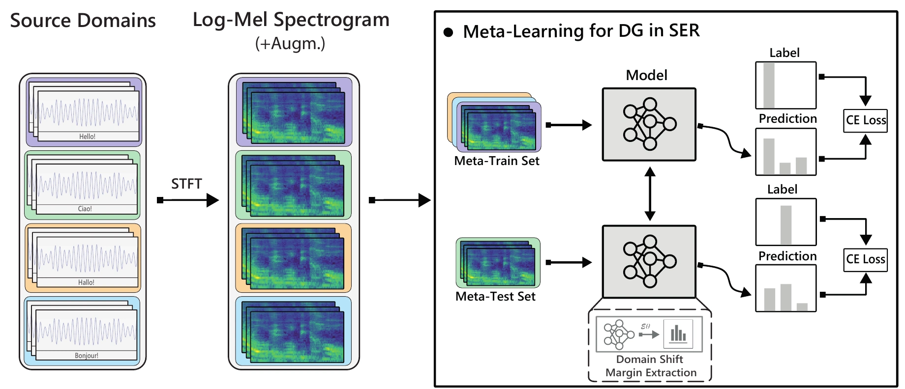

# DA-MLDG

**On efficacy of Meta-Learning for Domain Generalization in Speech Emotion Recognition**

Raeshak King Gandhi · Vasileios Tsouvalas · Nirvana Meratnia · PerFail @ IEEE PerCom 2023

[ Paper](https://ieeexplore.ieee.org/document/10150265/) · [ Project](https://nousphera.github.io/DA_MLDG/) · [Poster](https://nousphera.github.io/DA_MLDG/poster.pdf)

<p align="center">
  <a href="https://nousphera.github.io/DA_MLDG/#overview"></a>
</p>
<p align="center"><sub>Figure 1 · PerFail paper, p. 423. <a href="https://pure.tue.nl/ws/portalfiles/portal/346841444/On_efficacy_of_Meta-Learning_for_Domain_Generalization_in_Speech_Emotion_Recognition_2_.pdf#page=4">Original figure</a> · <a href="https://nousphera.github.io/DA_MLDG/#overview">Animated method overview</a></sub></p>

## Abstract

Speech Emotion Recognition (SER) refers to the recognition of human emotions from natural speech, vital for building human-centered context-aware intelligent systems. Here, domain shift, where models’ trained on one domain exhibit performance degradation when exposed to an unseen domain with different statistics, is a major limiting factor in SER applicability, as models have a strong dependence on speakers and languages characteristics used during training. Meta-Learning for Domain Generalization (MLDG) has shown great success in improving models’ generalization capacity and alleviate the domain shift problem in the vision domain; yet, its’ efficacy on SER remains largely unexplored. In this work, we propose a “domain-shift aware” MLDG approach to learn generalizable models across multiple domains in SER. Based on our extensive evaluation, we identify a number of pitfalls that contribute to poor models’ DG ability, and demonstrate that log-mel spectrograms representations lack distinct features required for MLDG in SER. We further explore the use of appropriate features to achieve DG in SER as to provide insides to future research directions for DG in SER.

## Requirements and installation

Use Python 3.11 or 3.12. The dependency lock targets Python 3.11 on macOS arm64 CPU.
A CPU is sufficient for the generated-data smoke.

```bash
git clone https://github.com/Nousphera/DA_MLDG.git
cd DA_MLDG
bash scripts/setup_env.sh "$HOME/.venvs/damldg"
source "$HOME/.venvs/damldg/bin/activate"
python -m pytest -q
```

The script creates a new virtual environment, installs `.[test]` using the tested
dependency constraints, and runs `pip check`. It refuses to modify an existing
environment. Training uses the `damldg/` package.

## Data preparation

Acquire the selected speech corpora from their providers under their access terms.
The [data guide](docs/DATA.md) lists all ten corpora, seven scenarios, label
mapping requirements, and import commands. For every raw corpus, supply a CSV
with provider-derived `path,emotion` labels; the same importer validates, hashes
and copies the recordings into the model's normalized layout:

```bash
python scripts/prepare_data.py import-corpus --corpus tess \
  --root /path/to/TESS --annotations /path/to/tess-labels.csv \
  --output datasets/ser/tess
```

Repeat for EmoDB and ShEMO to run scenario 7, then prepare and validate its manifest:

```bash
python scripts/prepare_data.py prepare --root datasets/ser --scenario scn7 --output data/scn7.json
python scripts/prepare_data.py validate --manifest data/scn7.json
```

If the normalized layout already exists, start with `prepare`.
The five class IDs are anger, happiness, sadness, disgust and fear. The importer
preserves speaker/session paths and audio bytes; it never guesses labels or
fabricates missing classes. PACS images, speaker pretraining and feature-array
inputs have [separate complete recipes](docs/DATA.md).

## Training

A bounded smoke trains the full ResNet-18 using a second-order DA-MLDG update
on generated source-domain features, then evaluates a held-out domain:

```bash
damldg train --config configs/smoke.json --output runs/smoke
```

For prepared scenario 7 audio:

```bash
damldg train --config configs/scn7.json --seed 2021 --output runs/scn7-seed2021
```

Use `configs/scn1.json` through `configs/scn7.json` for the other scenarios after
preparing their manifests. Select a baseline with `--method mldg`, `--method deepall`
or `--method rsc`, and a fresh `--output` directory. All four methods use
centralized source-domain training.

## Evaluation

The training command evaluates the final model on the held-out target corpus,
using no target examples in optimization or model selection. `metrics.json`
stores target `accuracy` as a fraction, cross-entropy `loss`, and `num_examples`.
Inspect the scenario 7 run above:

```bash
python - runs/scn7-seed2021/metrics.json <<'PY_METRICS'
import json
import sys
from pathlib import Path

metrics = json.loads(Path(sys.argv[1]).read_text())
target = metrics["target"]
print(f"{metrics['method']}: accuracy {100 * target['accuracy']:.2f}% on {target['num_examples']} target examples")
PY_METRICS
```

Repeat each scenario and method with ten recorded seeds and fresh output
directories to follow the paper's averaging protocol. The [scenario table](docs/DATA.md#speech-emotion-corpora)
defines the source corpora and held-out target for all seven settings.

## Pretraining

The published SER experiments initialize ResNet-18 with a speaker-trained
encoder. Prepare a locally acquired [VoxCeleb corpus](https://www.robots.ox.ac.uk/~vgg/data/voxceleb/)
with speaker directories, then train an encoder:

```bash
damldg prepare --kind speaker --root datasets/voxceleb --output data/voxceleb.json
damldg validate --manifest data/voxceleb.json
damldg train --config configs/pretrain.json --output runs/voxceleb-pretrain
```

Set `pretrained_encoder` in the downstream config to
`runs/voxceleb-pretrain/encoder.keras`. The supplied scenario configs use random
initialization until this field is set. See [encoder transfer](docs/DATA.md#speaker-pretraining-and-encoder-transfer)
for preprocessing and the speaker-label layout; [PACS experiments](docs/DATA.md#pacs)
use a compatible ImageNet-trained encoder.

## Results

**Published cross-corpus SER experiment — Table III.** Five selected emotions,
log-mel inputs and a VoxCeleb-pretrained ResNet-18. Values are target accuracy (%)
averaged over ten trials; higher is better. Each row uses the source-to-target
scenario defined in the paper's Table I. [Paper, Table III](https://pure.tue.nl/ws/portalfiles/portal/346841444/On_efficacy_of_Meta-Learning_for_Domain_Generalization_in_Speech_Emotion_Recognition_2_.pdf#page=6).

| Scenario · target corpus | Deep-All | RSC | MLDG | DA-MLDG |
|---|---:|---:|---:|---:|
| 1 · IEMOCAP | 26.95 | **32.36** | 27.61 | 31.35 |
| 2 · RAVDESS | 43.40 | **44.78** | 38.86 | 39.41 |
| 3 · TESS | **47.03** | 43.77 | 46.29 | 46.80 |
| 4 · CaFE | 43.16 | 39.97 | 42.57 | **43.21** |
| 5 · AESDD | 60.65 | 56.69 | 60.45 | **62.26** |
| 6 · ShEMO | 31.54 | **40.70** | 37.87 | 38.79 |
| 7 · ShEMO | 40.19 | **40.27** | 34.51 | 37.11 |

DA-MLDG improves over MLDG in every scenario; the strongest method varies across
corpora. Scenarios 6 and 7 share a target but use different source corpora.
[Explore the representation study and published results](https://nousphera.github.io/DA_MLDG/#findings).

## Configuration and outputs

Each run saves `config.json`, `partitions.json`, `environment.json`, `metrics.json`,
`model.keras`, and `encoder.keras`. Targets stay outside parameter updates and
are evaluated after training. The configs use random initialization until a
compatible `pretrained_encoder` is supplied. Set this field to a speaker-trained
encoder for SER or an ImageNet-trained encoder for PACS.

The [method and configuration guide](docs/METHOD.md) covers the objective,
batching, repeated runs and saved metrics. Feature extraction and tensor mapping
are described in the [data guide](docs/DATA.md).

## Citation

```bibtex
@inproceedings{gandhi2023damldg,
  author = {Gandhi, Raeshak King and Tsouvalas, Vasileios and Meratnia, Nirvana},
  title = {On efficacy of Meta-Learning for Domain Generalization in Speech Emotion Recognition},
  booktitle = {2023 IEEE International Conference on Pervasive Computing and Communications Workshops and other Affiliated Events (PerCom Workshops)},
  year = {2023},
  pages = {421--426},
  note = {PerFail 2023: Second International Workshop on Negative Results in Pervasive Computing},
  doi = {10.1109/PerComWorkshops56833.2023.10150265},
  url = {https://doi.org/10.1109/PerComWorkshops56833.2023.10150265}
}
```

## Source terms

A software license has not been specified. Contact the authors for reuse terms.
Dataset and external-model terms remain with their providers.
