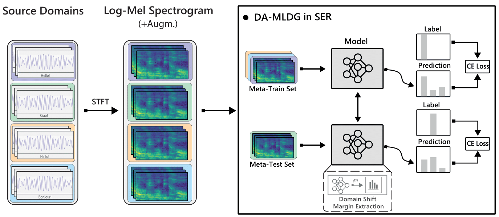

# DA-MLDG

Domain-shift aware meta-learning for speech emotion recognition. DA-MLDG adapts a ResNet-18 on some source domains, measures an energy gap to other source domains, and differentiates the weighted meta-test loss through that adaptation. The final target corpus stays outside training.

[Paper](https://doi.org/10.1109/PerComWorkshops56833.2023.10150265) · [Project page](https://nousphera.github.io/DA_MLDG/) · [Poster](https://nousphera.github.io/DA_MLDG/poster.pdf) · [Method mapping](docs/METHOD.md) · [Provenance](PROVENANCE.md)



## Install and run

Use Python 3.11 or 3.12. The maintained package uses TensorFlow 2.20 and Keras 3.

```bash
python3.11 -m venv .venv
source .venv/bin/activate
python -m pip install -e '.[test]'
python -m pytest -q

damldg train --config configs/smoke.json
```

The smoke runs a full ResNet-18 second-order update on generated features from three source domains and evaluates a fourth held-out domain. It writes the resolved config, partitions, environment, metrics, classifier, and encoder into a new output directory. It is a training-system check, not an SER benchmark. `python run.py` runs the same bounded smoke.

To compare the maintained baselines:

```bash
damldg train --config configs/smoke.json --method mldg --output runs/mldg-smoke
damldg train --config configs/smoke.json --method deepall --output runs/deepall-smoke
damldg train --config configs/smoke.json --method rsc --output runs/rsc-smoke
```

## Train on speech corpora

Obtain and prepare the corpora separately as `datasets/ser/<corpus>/<emotion>/*.wav`, using the five shared emotions: anger, happiness, sadness, disgust, and fear. The [data guide](docs/DATA.md) gives corpus names, scenarios, and the required preparation boundary. No audio or pretrained weights are included.

```bash
damldg prepare --root datasets/ser --scenario scn1 --output data/scn1.json
damldg train --config configs/scn1.json --seed 2021
```

The seven configs use the paper's two-second crops, batch size 32, SGD learning rate 0.05 and momentum 0.9, inner learning rate 0.01, and time-stretch/time-shift augmentation. Set `pretrained_encoder` to a compatible saved encoder to use pretrained initialization; the shipped configs explicitly use random initialization until one is supplied. Targets are evaluated only after training, without target-based checkpoint selection.

PACS images, prepared feature arrays, and speaker-classification pretraining are also supported; see [data and pretraining](docs/DATA.md). The original VoxCeleb checkpoint and TRILLsson extraction/reshape recipe were not recovered, so their paper results cannot be reproduced from this checkout alone.

## Correctness and reproducibility

The maintained implementation fixes a disconnected meta-update in the original source. Temporary parameters are now tensors used in Keras stateless calls; nested gradient tapes retain the required second-order derivative. Tests compare both MLDG and DA-MLDG gradients against finite differences and verify that changing meta-test labels changes the actual update. Full ResNet-18, generated WAV training, checkpoint transfer, and all baseline smoke paths are checked.

The paper reports limited and uneven generalization; this release does not claim improved benchmark accuracy or reproduction of its tables. [Reproducibility notes](docs/REPRODUCIBILITY.md) distinguish measured execution from missing historical artifacts. The original `src/` remains historical reference code; current commands use `damldg/`.

## Citation and source terms

```bibtex
@inproceedings{kinggandhi2023efficacy,
  author = {King Gandhi, Raeshak and Tsouvalas, Vasileios and Meratnia, Nirvana},
  title = {On efficacy of Meta-Learning for Domain Generalization in Speech Emotion Recognition},
  booktitle = {2023 IEEE International Conference on Pervasive Computing and Communications Workshops and other Affiliated Events},
  pages = {421--426}, year = {2023},
  doi = {10.1109/PerComWorkshops56833.2023.10150265}
}
```

The recovered repository contains no software license file. Original attribution is retained; reuse terms are unspecified, and no third-party license grant is inferred. Dataset and external-model terms remain with their providers.
