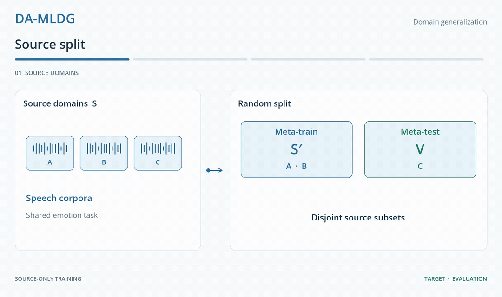

<h1 align="center">DA-MLDG</h1>
<p align="center"><strong>On efficacy of Meta-Learning for Domain Generalization in Speech Emotion Recognition</strong></p>
<p align="center">Raeshak King Gandhi · <a href="https://vtsouval.github.io/"><strong>Vasileios Tsouvalas</strong></a> · Nirvana Meratnia</p>

<p align="center">
  <a href="https://doi.org/10.1109/PerComWorkshops56833.2023.10150265" title="Read the paper"></a>
  <picture></picture>
  <a href="https://nousphera.github.io/projects/da-mldg/" title="Explore the project"></a>
  <picture></picture>
  <a href="https://nousphera.github.io/assets/posters/da-mldg-a0-landscape.pdf" title="View the poster"></a>
</p>

## Abstract

**Domain-shift Aware Meta-Learning for Domain Generalization (DA-MLDG)** studies how speech emotion models transfer to *unseen corpora, speakers and languages*. Each step divides the **source domains** into meta-train and meta-test groups, adapts a ResNet-18 on the first, then weights the second group's loss by their **energy-score gap**. The final target corpus remains *outside training*. Evaluation covers **ten speech corpora**, seven transfer scenarios and a separate PACS image benchmark, comparing **Deep-All, MLDG and RSC**. Stronger pretrained audio representations improve recognition, but *cross-corpus generalization remains uneven*.

<p align="center">
  <picture>
    <source media="(max-width: 600px) and (prefers-color-scheme: dark)" srcset="docs/assets/readme/method-dark-mobile.gif">
    <source media="(max-width: 600px)" srcset="docs/assets/readme/method-light-mobile.gif">
    <source media="(prefers-color-scheme: dark)" srcset="docs/assets/readme/method-dark.gif">
    
  </picture>
</p>

## Setup

Create and activate the `damldg` environment:

```bash
git clone https://github.com/Nousphera/DA-MLDG.git
cd DA-MLDG
python3.12 -m venv --prompt damldg "$HOME/.venvs/damldg"
source "$HOME/.venvs/damldg/bin/activate"
```

From the activated `damldg` environment, install the requirements:

```bash
python -m pip install -r requirements.txt
```

## Data and Weights

Download and prepare the corpora for a transfer scenario:

```bash
# TESS + EmoDB → ShEMO
python scripts/prepare_data.py --scenario scn7

# One corpus, or the complete collection
python scripts/prepare_data.py --dataset ravdess
python scripts/prepare_data.py
```

For access-controlled corpora, download from the provider and retain these layouts:

| Dataset | Provider | Location Under `raw/` |
|:--|:--|:--|
| SAVEE | [Surrey](http://kahlan.eps.surrey.ac.uk/savee/) | `savee/DC/a01.wav` (DC, JE, JK, KL) |
| IEMOCAP | [USC](https://sail.usc.edu/iemocap/) | `iemocap/Session1/…` through Session5 |
| EMOVO | [FUB](http://voice.fub.it/activities/corpora/emovo/) | `emovo/f1/rab-f1-b1.wav` (f1–f3, m1–m3) |
| AESDD | [AUTH](https://m3c.web.auth.gr/research/aesdd-speech-emotion-recognition/) | `aesdd/AESDD/<emotion>/*.wav` |

<details>
<summary><strong>Speech Transfer Scenarios</strong></summary>

| Scenario | Source Corpora | Target Corpus |
|:--|:--|:--|
| `scn1` | CREMA-D, SAVEE, RAVDESS | IEMOCAP |
| `scn2` | CREMA-D, SAVEE, TESS | RAVDESS |
| `scn3` | CREMA-D, SAVEE, RAVDESS | TESS |
| `scn4` | SAVEE, RAVDESS, EmoDB | CaFE |
| `scn5` | EMOVO, ShEMO, EmoDB | AESDD |
| `scn6` | CREMA-D, SAVEE, RAVDESS | ShEMO |
| `scn7` | TESS, EmoDB | ShEMO |

All scenarios use **anger, happiness, sadness, disgust and fear**. ShEMO has no disgust samples.

</details>

### Prepare Model

For speech, place an existing [VoxCeleb1](https://www.robots.ox.ac.uk/~vgg/data/voxceleb/vox1.html) copy (development + test) under `raw/voxceleb/id*/video/*.wav`, then pretrain **ResNet-18**. The provider no longer distributes its audio.

```bash
python scripts/prepare_data.py --dataset voxceleb
python scripts/prepare_model.py
```

An existing encoder can be imported with `--encoder /path/to/encoder.pt`.

## Run Experiments

From the repository root, run the **Flower App**:

```bash
common=(--scenario scn7 --epochs 50 --batch-size 32 --trials 10 \
        --learning-rate 0.05 --inner-lr 0.01 --momentum 0.9 --max-grad-norm 1)

# DA-MLDG
python scripts/run_experiment.py "${common[@]}" --method damldg

# Baselines
python scripts/run_experiment.py "${common[@]}" --method deepall
python scripts/run_experiment.py "${common[@]}" --method mldg
python scripts/run_experiment.py "${common[@]}" --method rsc
```

> [!NOTE]
> Flower schedules **independent seeded trials**; the target is evaluated only after training. Stability safeguards add a **gradient cap of 1** and final **source-only BatchNorm calibration** to every method and pretraining. Disable them with `--max-grad-norm 0 --no-bn-calibration`. Models and metrics are saved under `results/`.

<details>
<summary><strong>TRILLsson and PACS</strong></summary>

Prepare **TRILLsson3** embeddings and run the same speech experiment:

```bash
python scripts/prepare_model.py --model trillsson --scenario scn7
python scripts/run_experiment.py "${common[@]}" --representation trillsson
```

The official TRILLsson3 encoder is frozen. Its 1,024-dimensional output is arranged as a **32 × 32** single-channel input to ResNet-18.

Prepare **PACS** and its ImageNet encoder:

```bash
python scripts/prepare_data.py --dataset pacs
python scripts/prepare_model.py --model imagenet
python scripts/run_experiment.py --pacs-target sketch --trials 10
```

Select `art_painting`, `cartoon`, `photo` or `sketch` as the held-out target. The remaining domains supply training data.

</details>

Use `--parallel-trials` to run trials concurrently, `--backend sequential` for the same optimizer in one process, and `--help` for all settings.

## Citation

```bibtex
@inproceedings{gandhi2023damldg,
  title     = {On efficacy of Meta-Learning for Domain Generalization in Speech Emotion Recognition},
  author    = {Gandhi, Raeshak King and Tsouvalas, Vasileios and Meratnia, Nirvana},
  booktitle = {IEEE PerCom Workshops},
  year      = {2023},
  pages     = {421--426},
  doi       = {10.1109/PerComWorkshops56833.2023.10150265}
}
```
